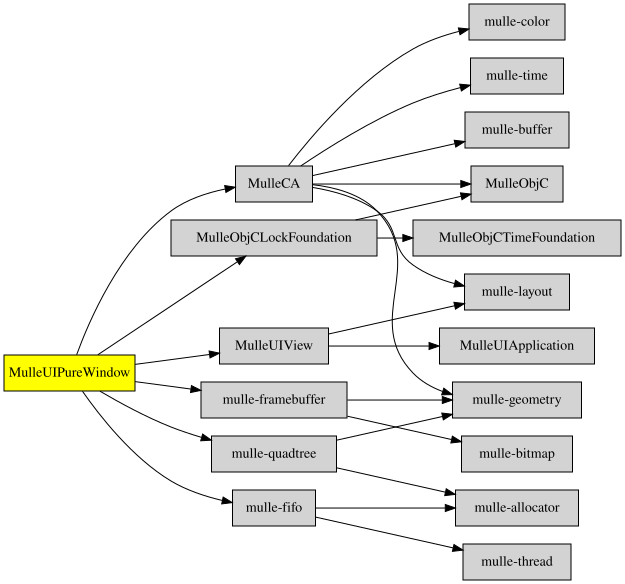

# MulleUIPureWindow

#### 👁️‍🗨️ MulleUIPureWindow - Windows without Views

The MulleUIPureWindow is a window with a framebuffer and a drawing context. The drawing context is
abstract, though it is usually a `CGContext` from [MulleGraphics](//github.com/MulleUI/MulleGraphics),
which provides `nanovg` and `OpenGL`.

MulleUIPureWindow provides the "retained" window mode, that is based on an invisible window
being used to construct the framebuffer in a separate thread, which is then displayed in the
visible window on the main thread.

MulleUIPureWindow handles events. It knows about UIResponder and will forward events along
the responder chain.

MulleUIPureWindow is also notable, for what it does not do. It does not have a UIView hierarchy. In fact
it does not know about UIViews at all. It has no layout system and it has no animation system. It
has no support for UITrackingAreas.

There is no actual "drawing" code in MulleUIPureWindow. Use "MulleGraphics" for
drawing.


| Release Version                                       | Release Notes
|-------------------------------------------------------|--------------
|  [](//github.com/MulleUI/MulleUIPureWindow/actions) | [RELEASENOTES](RELEASENOTES.md) |


## MulleUIPureWindow: The Crystalline Canvas of Your Digital Domain

Welcome, intrepid code explorers, to the magnificent realm of MulleUIPureWindow - the jewel in the crown of the MulleUICore collection! This library stands as a testament to elegant window management, providing developers with the most pristine and unadulterated window abstraction layer one could possibly imagine.

### A Windowed Wonderland

MulleUIPureWindow dances gracefully at the intersection of simplicity and power, offering a "pure" approach to window management that remains blissfully unencumbered by the chaotic whims of platform-specific peculiarities. Like a master glassblower crafting the perfect pane, this library shapes your application's viewport with precision and artistry.

Within its meticulously crafted codebase, you'll discover a treasure trove of window manipulation capabilities - from the humble act of creation to the grand gesture of resizing, all executed with the refined elegance of a digital ballet.

### Pure as Mountain Spring Water
The "Pure" in MulleUIPureWindow isn't mere marketing fluff - it's a philosophical commitment! This library steadfastly adheres to functional purity principles where possible, minimizing side effects and maximizing predictability. Your windows won't mysteriously change state when you're not looking; they'll behave with the mathematical certainty of well-defined functions.

### Features That Flutter the Heart

* Crystalline Abstraction Layer - Separating your application logic from the gritty details of window management
* Pixel-Perfect Positioning - Because a window misplaced is an opportunity missed
* Responsive Resizing Routines - Adapting to user needs faster than a chameleon on a disco floor
* Event Handling Extraordinaire - Capturing user interactions with the enthusiastic precision of a butterfly collector
* Cross-Platform Compatibility - Because your windows should feel at home on any operating system they visit

MulleUIPureWindow isn't just a library; it's an experience - a journey through the looking glass into a world where windows aren't just rectangular spaces on a screen, but portals to possibility. Whether you're crafting a humble utility or an expansive digital ecosystem, this library stands ready to frame your vision with unparalleled clarity and style.

So go forth, brave developer! Let MulleUIPureWindow be the canvas upon which you paint your digital masterpiece!brave developer! Let MulleUIPureWindow be the canvas upon which you paint your digital masterpiece!
### You are here




## Add

Use [mulle-sde](//github.com/mulle-sde) to add MulleUIPureWindow to your project:

``` sh
mulle-sde add github:MulleUI/MulleUIPureWindow
```

To only add the sources of MulleUIPureWindow with dependency
sources use [clib](https://github.com/clibs/clib):


``` sh
clib install --out src/MulleUI MulleUI/MulleUIPureWindow
```

Add `-isystem src/MulleUI` to your `CFLAGS` and compile all the sources that were downloaded with your project.


## Install

Use [mulle-sde](//github.com/mulle-sde) to build and install MulleUIPureWindow and all dependencies:

``` sh
mulle-sde install --prefix /usr/local \
   https://github.com/MulleUI/MulleUIPureWindow/archive/latest.tar.gz
```

### Legacy Installation

Install the requirements:

| Requirements                                 | Description
|----------------------------------------------|-----------------------
| [MulleUIApplication](https://github.com/MulleUI/MulleUIApplication)             | 𝄢 MulleUIApplication provides abstract classes like UIApplication and UIEvent
| [MulleInvocationQueue](https://github.com/MulleFoundation/MulleInvocationQueue)             | 🚶🚶🚶 MulleInvocationQueue runs methods in a separate thread
| [mulle-objc-list](https://github.com/mulle-objc/mulle-objc-list)             | 📒 Lists mulle-objc runtime information contained in executables.

Download the latest [tar](https://github.com/MulleUI/MulleUIPureWindow/archive/refs/tags/latest.tar.gz) or [zip](https://github.com/MulleUI/MulleUIPureWindow/archive/refs/tags/latest.zip) archive and unpack it.

Install **MulleUIPureWindow** into `/usr/local` with [cmake](https://cmake.org):

``` sh
cmake -B build \
      -DCMAKE_INSTALL_PREFIX=/usr/local \
      -DCMAKE_PREFIX_PATH=/usr/local \
      -DCMAKE_BUILD_TYPE=Release &&
cmake --build build --config Release &&
cmake --install build --config Release
```


## Author

[Nat!](https://mulle-kybernetik.com/weblog) for Mulle kybernetiK  


